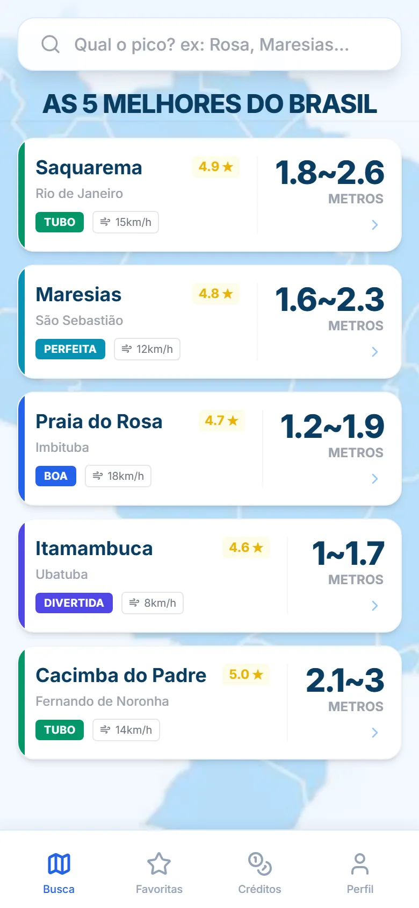
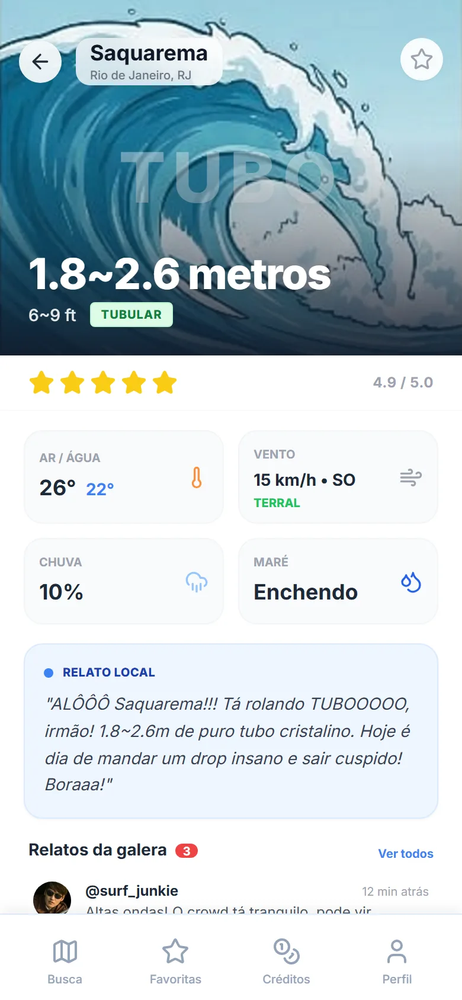
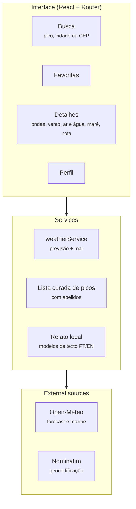

# Wave4meNow

> A mobile-first surf forecast with the best beaches right now, smart search and a spot report in surfer voice.

[Ler em português](README.md) · [See the other work in the portfolio](https://github.com/gabrieldacostarosa/portfolio)

| | |
|---|---|
| **Status** | Live |
| **My role** | Complete design and development. |
| **Stack** | `React 19` `Vite` `React Router` `Open-Meteo` `Nominatim` `Mobile-first` |
| **Open live** | https://wave4menow.netlify.app |

## Problem

Knowing in seconds where it's good to surf right now, with scattered technical data brought onto a phone screen.

## Result

A top 5 of the moment, search by spot, city or postal code, wave, wind and tide forecast and official bilingual documentation (PT-BR and EN).

## Screens

 

## Context and problem

Surfers want to know, in seconds, where it's good right now. The data exists but it is scattered and technical. I wanted to bring weather, sea and wind onto one screen designed for the phone, in hand, at the beach, with the spot's rating and a local report in surfer language.

## What was built

- A home screen with Brazil's five best beaches right now, showing wave height, wind, the kind of condition (barrel, perfect, good) and a rating.
- Search by spot, city or postal code, with accent normalization and aliases for local spots (such as the slang name for Prainha da Guarda). When a result is chosen, the app fetches forecast and marine data from Open-Meteo.
- A spot detail with wave height in meters and feet, wind and direction (for example, offshore), air and water temperature, chance of rain, tide and rating.
- A spot profile with a local report and rating. The documentation plans for reports and ratings from the community; in the published code, the report is filled by rules and text templates in Portuguese and English (from the height, wave type and rating), with no dependence on AI.
- Favorites, alerts, comments and profile, with bottom-bar navigation.
- Official bilingual documentation (PT-BR and EN) in a public repository: app introduction, a quick-start guide, detailed features (search, spot profile, favorites, settings), upcoming features and an FAQ.

## Architecture

Services sit between the interface and the external sources, so a source can be swapped without touching the screens.

## Decisions and trade-offs

| Decision | Why | Cost |
|---|---|---|
| Local search first, geocoding second | Curated spots and their aliases take top priority, because generic geocoders get small beaches wrong. The API fills in what the list doesn't cover, forcing a beach context in the query. | The curated list needs manual upkeep. |
| Public, keyless APIs for weather and sea | Open-Meteo delivers forecast and marine data with no credentials, so cost and leaked-secret risk are zero for that part. | I depend on third-party limits and availability. |
| A report from text templates, instead of AI | The report comes from rules (height, wave type, rating) and hand-written phrases, in PT and EN. It costs nothing, has no wait and the voice never goes off-tone. | Less variety than an AI and the need to maintain the templates. |
| Curated spots load without calling APIs | The home screen and the detail of curated spots open instantly, without waiting for the network. | The values of curated spots are fixed; only search results bring a live forecast. |
| Postal codes recognized by regular expression | Someone who types a postal code is taken straight to the right region, without needing the spot's name. | It covers only the Brazilian format. |

## Quality and security

- Normalized text (no accents, case-insensitive) on every search.
- The home screen opens without any data API call, so it loads instantly.
- Layout designed phone-first, with a bottom navigation bar.

## What I would change

- Connect the live forecast to the curated home spots too, which today have fixed values.
- Cache forecast and geocoding calls to respect API limits and speed up the screen.
- Write automated tests for the search service, which holds the most delicate logic.
- Replace the runtime Tailwind CDN with CSS generated at build time.

---

**All rights reserved.** This repository holds the project's documentation. The source code is private.
