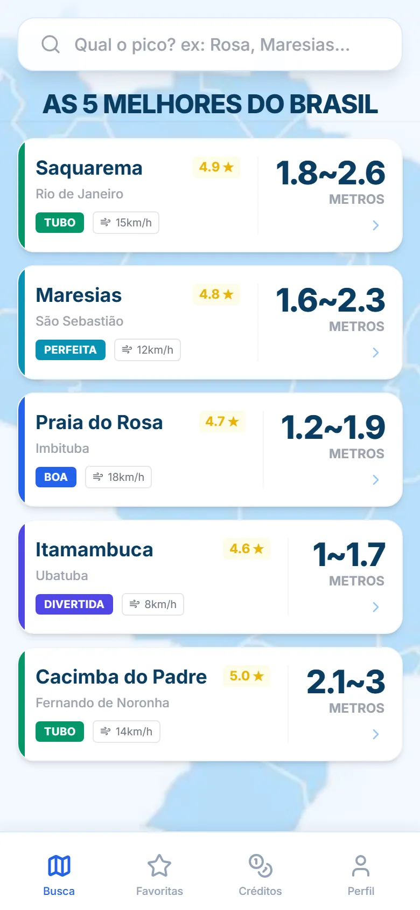
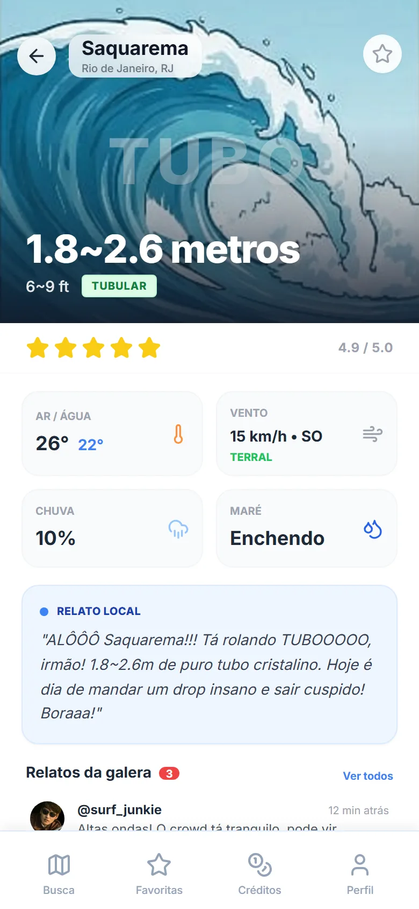
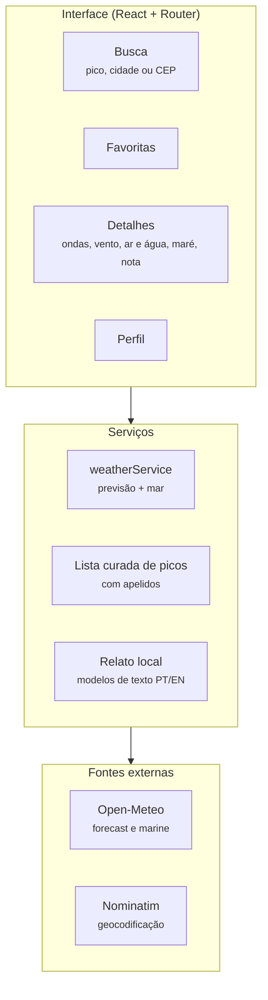

# Wave4meNow

> Previsão de surfe mobile-first com as melhores praias do momento, busca inteligente e relato do pico em voz de surfista.

[Read in English](README.en.md) · [Veja os outros trabalhos no portfólio](https://github.com/gabrieldacostarosa/portfolio)

| | |
|---|---|
| **Situação** | No ar |
| **Meu papel** | Projeto e desenvolvimento completos. |
| **Stack** | `React 19` `Vite` `React Router` `Open-Meteo` `Nominatim` `Mobile-first` |
| **Abrir ao vivo** | https://wave4menow.netlify.app |

## Problema

Saber em segundos onde está bom para surfar agora, com dados dispersos e técnicos reunidos numa tela de celular.

## Resultado

Top 5 do momento, busca por pico, cidade ou CEP, previsão de ondas, vento e maré e documentação oficial bilíngue (PT-BR e EN).

## Telas

 

## Contexto e problema

Quem surfa quer saber, em segundos, onde está bom agora. Os dados existem, mas estão espalhados e em formato técnico. Quis juntar clima, mar e vento numa tela pensada para o celular, na mão, na praia, com a nota do pico e um relato local em linguagem de surfista.

## O que foi construído

- Home com as cinco melhores praias do Brasil agora, mostrando altura das ondas, vento, tipo de condição (tubo, perfeita, boa) e nota.
- Busca por pico, cidade ou CEP, com normalização de acentos e apelidos de picos locais (como a gíria para a Prainha da Guarda). Ao escolher um resultado, o app busca previsão e dados de mar na Open-Meteo.
- Detalhe do pico com altura das ondas em metros e pés, vento e direção (por exemplo, terral), temperatura do ar e da água, chance de chuva, maré e nota.
- Perfil do pico com relato local e rating. A documentação prevê relatos e notas da comunidade; no código publicado, o relato é preenchido por regras e modelos de texto em português e inglês (a partir da altura, do tipo de onda e da nota), sem depender de IA.
- Favoritas, alertas, comentários e perfil, com navegação por barra inferior.
- Documentação oficial bilíngue (PT-BR e EN) em repositório público: introdução ao app, guia rápido de primeiros passos, funcionalidades detalhadas (busca, perfil do pico, favoritos, configurações), recursos futuros e perguntas frequentes.

## Arquitetura

Os serviços ficam entre a interface e as fontes externas, o que permite trocar uma fonte sem mexer nas telas.

## Decisões e trade-offs

| Decisão | Por quê | Custo |
|---|---|---|
| Busca local primeiro, geocodificação depois | Os picos curados e seus apelidos têm prioridade máxima, porque geocodificadores genéricos erram praias pequenas. A API complementa o que a lista não cobre, forçando o contexto de praia na consulta. | A lista curada precisa de manutenção manual. |
| APIs públicas sem chave para clima e mar | A Open-Meteo entrega previsão e dados marinhos sem credencial, então o custo e o risco de segredo vazado são zero para essa parte. | Dependo de limites e da disponibilidade de serviços de terceiros. |
| Relato por modelos de texto, em vez de IA | O relato nasce de regras (altura, tipo de onda, nota) e de frases escritas à mão, em PT e EN. Não tem custo, não tem espera e a voz nunca sai do tom. | Menos variedade que uma IA e a necessidade de manter os modelos. |
| Picos curados carregam sem chamar APIs | A tela inicial e o detalhe dos picos curados abrem na hora, sem esperar rede. | Os valores dos picos curados são fixos; só os resultados da busca trazem previsão em tempo real. |
| CEP reconhecido por expressão regular | Quem digita um CEP é levado direto para a região certa, sem precisar saber o nome do pico. | Cobre só o formato brasileiro. |

## Qualidade e segurança

- Texto normalizado (sem acentos e sem diferença de caixa) em toda busca.
- A tela inicial abre sem nenhuma chamada a APIs de dados, então carrega na hora.
- Layout pensado primeiro para o celular, com barra de navegação inferior.

## O que eu mudaria

- Ligar a previsão em tempo real também aos picos curados da home, que hoje têm valores fixos.
- Guardar em cache as chamadas de previsão e de geocodificação para respeitar os limites das APIs e acelerar a tela.
- Escrever testes automatizados para o serviço de busca, que concentra a lógica mais delicada.
- Trocar o Tailwind carregado por CDN em tempo de execução por CSS gerado no build.

---

**Todos os direitos reservados.** Este repositório contém a documentação do projeto. O código-fonte é privado.
